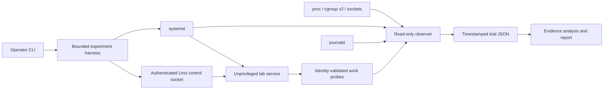

# Linux Systems & Reliability Platform

[](https://github.com/ThePhysic/linux-systems-reliability-platform/actions/workflows/tests.yml)

LSRP is a terminal-based Linux reliability laboratory: a real, unprivileged service runs under systemd while a bounded experiment harness reproduces failures, correlates `/proc`, cgroup, journal, socket, and request evidence, and verifies functional recovery. Each incident asks: **What can I prove is happening to this service, and how do I know it recovered?** Saved records make the diagnosis, timing, and cleanup claims independently inspectable.

## Verified results

| Check | Recorded result | Evidence |
| --- | --- | --- |
| Linux unit tests | **100 passed** | [Saved Linux test log](examples/robustness/validation/unit-tests.txt) |
| Real Linux incident trials | **12/12 recovered**, three per scenario | [Validation summary](examples/robustness/validation/validation-summary.json) |
| Interruption validation | **8/8 checks passed**, including SIGTERM cleanup and independent recovery after SIGKILL | [Interruption record](examples/robustness/interruption/validation.json) |
| Hosted portable CI | **4/4 jobs passed** at `24119e4`: Ubuntu/Windows × Python 3.11/3.13 | [Recorded CI run](https://github.com/ThePhysic/linux-systems-reliability-platform/actions/runs/41381466023), [workflow](.github/workflows/tests.yml) |

The [saved Linux validation](examples/robustness/README.md) ran in a dedicated **Ubuntu 24.04 WSL2 lab** at source revision [`e49d359`](https://github.com/ThePhysic/linux-systems-reliability-platform/commit/e49d3595eaa23410223790f5cebf3c4643f10a9e). Hosted CI runs portable checks; privileged systemd fault integration has separate Linux evidence. These records describe their named revisions and environment; current report presentation can differ.

**[See a real incident: a live process that stopped serving work](docs/DEMO.md).** Read the evidence and run the saved report on Windows or Linux, without root or a running lab.

## What you can demonstrate

| Experiment | What to investigate |
| --- | --- |
| `crash` | Process identity changes, signal/exit evidence, restart policy, and request unavailability |
| `hang` | A live process and listener while readiness/work requests fail |
| `cpu` | Service-local CPU pressure, cgroup throttling counters, and request latency |
| `collision` | An owned conflicting listener, bind failure, and startup recovery |

Reports separate observations, hypotheses, experiment ground truth, recovery actions, and limitations. Missing or inaccessible data stays missing. A systemd `active` state or a replacement PID alone cannot establish recovery.

The scope is one service, one CLI, and these four incidents. A web dashboard, memory/FD exhaustion, eBPF, and advanced networking experiments are deferred.

## Requirements

- A **disposable Linux VM or dedicated WSL2 distribution**, with systemd running as PID 1.
- Python 3.11 or newer, systemd/journald, cgroup v2 with CPU and memory controllers, and `ss` from `iproute2`.
- Root for installation, service control, and fault experiments. The service itself runs as `lsrp-lab`, without root privileges.

The implementation uses Python's standard library. Application dependencies, Docker, Kubernetes, and a database are unnecessary. Windows can run the portable unit tests and read saved reports; Linux service experiments run inside the lab.

## Windows: create a dedicated WSL2 lab

From PowerShell in this checkout, with WSL2 already available:

```powershell
python scripts/wsl_lab.py create
python scripts/wsl_lab.py validate --run first-run
python scripts/wsl_lab.py fetch --run first-run
```

The helper downloads a checksum-pinned official Ubuntu image, imports a **new** distribution named `LSRP-Lab`, disables Windows-drive automount and Windows executable interoperability in that distribution, enables systemd, transfers source through stdin, and installs the lab. It refuses to overwrite an existing distribution and never unregisters one. Runtime files and fetched evidence live in `~/lsrp-lab-runtime`, outside this repository. It does not change global `.wslconfig` settings or other distributions.

After code changes, use `python scripts/wsl_lab.py sync --install`, then validate with a new run name. The helper manages only a distribution carrying its own creation marker. See [Windows/WSL instructions](docs/WSL.md) for options, boundaries, and source-hash provenance.

## Quickstart

Run these commands **inside the disposable Linux lab**, from a checkout of this repository. On Ubuntu, install the prerequisites first:

```bash
sudo apt-get update
sudo apt-get install -y python3 systemd iproute2
python3 --version
ps -p 1 -o comm=
test -f /sys/fs/cgroup/cgroup.controllers
```

Install the fixed units and root-owned service code, then inspect the environment:

```bash
sudo bash scripts/install-lab.sh --accept-disposable-lab
python3 -m lsrp doctor --json
sudo python3 -m lsrp start
python3 -m lsrp status --json
```

Record one incident and read its report:

```bash
sudo python3 -m lsrp run hang --duration 4 --output artifacts/hang.json
python3 -m lsrp report artifacts/hang.json
```

Compare repeated trials and measure the observer's effect:

```bash
sudo python3 -m lsrp suite --trials 3 --duration 4 --output artifacts/trials
python3 -m lsrp compare artifacts/trials --json
sudo python3 -m lsrp overhead --trials 3 --duration 4 --output artifacts/overhead.json
```

`--duration` controls the bounded fault interval, not the entire trial. Baseline, supervision, cleanup, and recovery checks add time. A failed or inconclusive experiment returns a nonzero exit status and preserves its record; inspect the saved report before rerunning.

For an end-to-end verification with saved evidence:

```bash
sudo bash scripts/validate-linux.sh artifacts/validation
```

The script runs meaningful automated tests, checks normal lifecycle, executes three trials of each incident, checks records and sustained recovery, and records observation overhead. See [validation](docs/VALIDATION.md) for artifact interpretation and the distinction between portable tests and real Linux integration.

## Commands

| Command | Purpose | Privilege |
| --- | --- | --- |
| `doctor [--json]` | Check platform, tools, and lab prerequisites | Read only |
| `status [--json]` | Collect one correlated evidence snapshot | Read only; some evidence may require root |
| `start`, `stop` | Operate the fixed lab service | Root |
| `run SCENARIO --output FILE` | Record one controlled incident | Root |
| `suite --output DIR` | Run all four incidents repeatedly | Root |
| `report FILE [--json]` | Explain a saved incident | Read only; works offline |
| `compare FILE_OR_DIR... [--json]` | Aggregate saved trial measurements | Read only; works offline |
| `overhead --output FILE` | Compare workload with and without collection | Root |
| `cleanup` | Remove active fault conditions and restore the lab | Root |

Use `python3 -m lsrp --help` and command-specific `--help` for options. If installed as a Python package, the `lsrp` console script is equivalent.

## Boundaries and cleanup

The lab binds only `127.0.0.1:18765`. Fault control accepts only fixed lab units and authenticated local control requests. The marker `/etc/lsrp/lab.json` binds the installation to its machine identity. Mutations require verified ownership and are serialized. Service resource limits and fault deadlines provide independent containment if a CLI run is interrupted.

```bash
sudo python3 -m lsrp cleanup
sudo python3 -m lsrp stop
sudo bash scripts/uninstall-lab.sh --accept-disposable-lab
```

Keep the lab isolated from production workloads. The safety checks are engineering boundaries for this laboratory, not a guarantee against a malicious root user. See [safety](docs/SAFETY.md) for preconditions, interruption behavior, and remaining limits.

## How it works



Read the [architecture](docs/ARCHITECTURE.md), [diagnostic walkthrough](docs/DIAGNOSTICS.md), and [evidence and measurement semantics](docs/EVIDENCE.md). The original [idea package](docs/concept/README.md) is preserved for scope traceability.

## Development

The [recorded evidence index](examples/README.md) separates the latest robustness validation from the earlier historical run. The [AI-assisted adversarial code-review history](docs/REVIEW.md) preserves development findings, fixes, and regression checks.

```bash
python3 -m unittest discover -s tests -v
python3 -m compileall -q lsrp tests
```

Unit tests exercise parsers, diagnosis, measurement semantics, identity validation, service behavior, and CLI contracts. They do not establish that systemd restart or cgroup controls work on a particular host; that requires the Linux validation run.

No performance improvement is promised. Any example numbers must come from recorded experiments, with their environment, sample counts, sampling limits, and source revision. Successful laboratory trials demonstrate this implementation in that environment; they do not establish production high availability.

## License

[MIT](LICENSE). Copyright 2026 ThePhysic.
